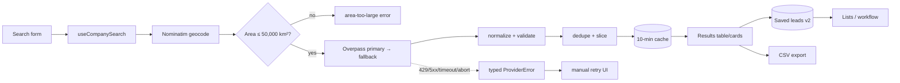

# LeadScout — Product Overview & Capability Audit

*Audit date: 2026-10-10. Method: source inspection of the working tree at commit `85041eb` (clean), plus `typecheck` / `lint` / `bun test` / `next build` runs and two light live HTTP probes (one Nominatim query, one minimal Overpass query). No browser testing harness exists in the repo; no dev server was started; no code was changed for this audit.*

## 0. Executive summary

1. **Product summary:** LeadScout is a frontend-only Next.js app that helps freelance web developers find local businesses (potential web-design clients) using free OpenStreetMap data, then save, qualify, organize, and export them as CSV. All user data lives in the browser; there is no backend, account, or paid API.
2. **Primary user goal:** describe a business type, optionally narrow by location, and receive a useful list of matching companies with available contact information.
3. **Current-state verdict:** the core value is **implemented but externally unverifiable end-to-end from restricted networks** — the full live pipeline (geocode → Overpass → normalize → dedupe → display → save → export) exists with typed errors, caching, and 156 passing tests, but a live Overpass round-trip has not been observed from the sandboxes used so far, and Overpass is unreachable from the current one.
4. **Most important known limitation:** live results depend entirely on community-mapped OSM data plus public Overpass availability; the app cannot find businesses that are not mapped, cannot enrich records beyond source tags, and coverage/completeness vary wildly by area.
5. **Three highest-priority next steps:**
   - **P0:** Verify one real live search (e.g. dentists in Dhaka) from an unrestricted network, or treat live discovery as unverified.
   - **P1:** Close the category-coverage gap — the generic "all categories" fallback queries only `shop`/`office`/`craft` and silently misses `amenity=*` businesses (restaurants, cafés).
   - **P1:** Decide the website/contact enrichment strategy, because OSM tags alone rarely supply phone/email — the scarcest fields for outreach.

## 1. Product purpose: core value vs supporting features

**Core product value** — finding businesses and returning useful information — is the only thing that justifies everything else. Concretely: a filterable list of real business names with location, category, and whatever contact details (website, phone, email, hours, coordinates) the source provides, each traceable to its OSM record.

**Supporting features** — search filters/sorting/presets, heuristic fit score, data-completeness meter, save/unsave, lists with member management, qualification statuses, research notes/follow-ups, CSV export (saved + search scopes), theme/settings, caching/retry/attribution — are all implemented and all depend on the core working. Verdict on the core: **implemented, honestly labeled (demo vs live, truncated vs exhaustive), but live end-to-end success is unverified from here** (see §3, §11). The supporting layer is complete and does not need expansion before the core is proven.

## 2. Actual user experience

Journey: Dashboard (`/`) → Find Companies (`/find-companies`: Live/Demo mode toggle, country/city/category/keyword/max-results form, submit) → loading skeleton → results table/cards (name, category, location, contact availability, source badge, optional fit score, Save action) → result refinement (availability filters, min score, sort, removable chips) → save → Saved Leads (`/saved-leads`: OSM + demo sections, status filter, per-lead research panel, CSV export) → Lists (`/lists`: create/rename/delete, add/remove members, read-only sample list) → Settings (`/settings`: theme, source info, local-data reset). Filters/sort/presets persist in shareable URLs; submitted searches write the URL without clobbering in-progress typing.

### Walkthrough: dental clinics in Dhaka, Bangladesh

| Step | Status | Evidence / notes |
|---|---|---|
| Select Live mode, enter category + city | Works | Mode toggle + validated form (`live-search-section.tsx`); category list includes Dental Clinic |
| Category mapped to data query | Works | `Dental Clinic → amenity=dentist` (exact, non-approximate mapping) |
| Dhaka resolved to a search area | Works with limitations | Nominatim free-text lookup, cached 30 days; verified live (HTTP 200) from this sandbox. Ambiguous/vernacular names (e.g. "Malibagh" spelling variants) depend on Nominatim returning the right bbox |
| Live business fetch | Unable to verify | Overpass unreachable from this sandbox (HTTP 406 on a well-formed query); code path covered by stubbed-fetch tests only |
| Results displayed with details | Works with limitations | Table/cards, availability badges, completeness meter, score breakdown, OSM record links — all render from whatever the provider returns; empty/no-match/rate-limit/timeout states with retry exist |
| Open a website | Works with limitations | Only when the OSM record carries a `website`/`contact:website` tag (scheme-validated, https defaulted); otherwise an honest "Not available" badge — no discovery beyond the tag |
| Save / lists / notes / status | Works | v2 records, namespaced ids, per-lead workflow panel, list membership; persists across refreshes (unit-tested migration/sanitize) |
| Export results | Works | Filtered-set CSV (`leadscout-search-…csv`) and saved-leads CSV (`leadscout-leads-…csv`); UTF-8 BOM, RFC 4180 quoting, formula-injection guard (unit-tested) |
| Repeat visit later | Works with limitations | Saved data, lists, notes, presets, theme all restore from localStorage; live *results* are ephemeral (must re-search) |

Variant verdicts: **Malibagh (narrower area)** — works with limitations (same pipeline; sub-city Nominatim resolution is the only extra dependency). **Software companies in Dhaka** — works with limitations (no IT-specific tag mapping; falls back to generic `shop`/`office`/`craft`, so recall for `office=software`-style firms is incidental, not designed). **Restaurants** — works with limitations and a real gap: no restaurant category exists and the generic fallback omits `amenity=*` entirely, so amenity-tagged restaurants are systematically missed (see §13 P1).

## 3. How search actually works

Plain-language pipeline (`src/lib/providers/index.ts` orchestrates; UI entry `src/components/find-companies/` via `src/hooks/use-company-search.ts`):

1. **Query interpretation:** category → allowlisted OSM tag pairs (`osm-tags.ts`); keyword sanitized (letters/numbers/spaces/hyphens/apostrophes, 40 chars) into a case-insensitive `["name"~"...",i]` regex; raw input never enters query syntax.
2. **Location resolution:** city/country free text → Nominatim `search?format=jsonv2&limit=1` → first result's bounding box + display label; results cached 30 days (50-entry cap). Only on explicit submit, never per keystroke (≤1 req/s policy respected by construction).
3. **Boundaries:** validated finite bbox; areas over 50,000 km² are refused with a narrow-your-search error (`geo.ts`).
4. **Data source queried:** Overpass QL against `https://overpass-api.de/api/interpreter`, single fallback to `https://overpass.kumi.systems/api/interpreter` on transport errors only (never on 429). Client timeout 30 s, server `[timeout:25]`; fetch up to `min(limit*2, 100)` elements, app slices to `maxResults` (≤50).
5. **Retrieval:** `node`/`way`/`relation` elements carrying a `name` tag, `out center tags` (ways/relations resolve to centroid points, small payloads).
6. **Normalization** (`normalizeElement`): stable `osm:{type}/{id}` ids; name trimmed (nameless records dropped); coordinates validated finite (null otherwise); city/country from `addr:*` tags with geocode fallback; website/phone/email/opening-hours taken only from explicit tags and otherwise `null`; source URL built per record; raw tags retained.
7. **Dedup:** stable OSM id primary key plus name + rounded-coordinate secondary key — same business modeled twice collapses; distinct same-name businesses survive.
8. **Filter/rank/sort/score:** provider filters (country/city/category/keyword/limit) shape the request and cache key; availability filters, min-score, and sorting (`provider`/`relevance`/`name`/`info`/`score`, stable, missing-values-last) apply client-side to fetched results only, badged "Narrowed locally" with per-chip removal. Fit score (website 30, phone 20, category 15, email 15, hours 10, city-tags 10; bands 70+/40+) measures mapped completeness, labeled heuristic throughout.
9. **Caching:** 10-minute / 50-entry result cache keyed by normalized provider params only; simultaneous identical searches share one in-flight promise; failures/aborts never cached; debounced submits (300 ms), per-run AbortController, request-id staleness guard, cleanup on unmount/reset.
10. **Results/errors to UI:** `Company[]` + meta (area label, km², truncation flag, examined count) or typed `ProviderError` (`needs-location`, `location-not-found`, `area-too-large`, `timeout`, `rate-limit`, `network`, `bad-response`) with per-kind messages and manual retry only.

**Per-source account:** Nominatim supplies bbox + display name + city/country (free, no key, 1 req/s policy, browser-direct, verified live HTTP 200 from here). Overpass supplies business objects with tags (free, no key, fair-use + timeout/rate behavior, browser-direct GET). Neither guarantees completeness; OSM has no revenue/employees/ratings/descriptions/social data. **Fallback status:** implemented (secondary endpoint, no-429 rule) but live fallback success unverified — like all Overpass traffic from here, it cannot be observed succeeding.

**The reported live failure** ("Could not reach the data service. Check your connection and try again."): this exact string is emitted only by `toProviderError`'s `TypeError` branch (`src/lib/providers/http.ts:42-47`) — i.e. the `fetch()` itself threw at transport level (DNS/blocked host/CORS preflight failure/refused connection) during the Overpass stage, after Nominatim had already succeeded. Failing stage: Overpass fetch. Likely root cause from sandbox evidence: egress filtering of `overpass-api.de` (reproducible HTTP 406 on a well-formed probe; the app maps non-429/5xx statuses to `network`). Classification as retryable `network` (not rate-limit/timeout) is correct. **What would confirm it:** one browser devtools capture of the failing request (status code, CORS headers, timing) from an affected user network; a repeated-406 signature would point at filtering/proxy rather than the app.

## 4. Field inventory (data model vs reality)

| Field | In model | Populated by providers | Source | Verified live |
|---|---|---|---|---|
| Name | yes (required) | yes — `name` tag; nameless dropped | OSM | No (stub tests only) |
| Category | yes (always labeled) | yes — matched tag or prettified fallback | Derived | No |
| City / country / location label | yes, nullable + label | `addr:*` tags or geocode fallback | OSM + Nominatim | Partial (Nominatim yes) |
| Coordinates | yes, nullable | node lat/lon or way/relation centroid; null otherwise | OSM | No |
| Website | yes, nullable | `website`/`contact:website` only | OSM | No |
| Phone | yes, nullable | `phone`/`contact:phone` only | OSM | No |
| Email | yes, nullable | `email`/`contact:email` only (rare) | OSM | No |
| Opening hours | yes, nullable | `opening_hours` only | OSM | No |
| Description | **No** | — | — | — |
| Social links | **No** | — | — | — |
| Source + record URL | yes | always constructed | OSM id | No (URL pattern trivially correct) |
| Freshness/last-checked | **No** | — | — | — |
| Confidence/quality | heuristic score + completeness only, labeled as such | derived | — | — |

The app distinguishes missing (`null` → "Not available"/"Unknown") from present throughout; nothing is inferred. **"Not available" vs "not yet checked"** is partially modeled: fields are tri-state only insofar as `null` = absent-from-source; there is no "pending check" state, which is correct since no follow-up check exists.

**Websites:** search *returns* URLs only when tags supply them — it does not discover them. Users can open them (scheme-validated, `https` defaulted, unsafe protocols rejected as inert text, `noopener noreferrer`). **No fetching, scraping, Google search, or email extraction exists anywhere** — `fetch(` occurs only in `providers/http.ts` (confirmed by repo-wide grep). Adding site scraping would require CORS-friendly targets (most business sites block cross-origin reads), robots/ToS compliance per site, rate limiting, and HTML parsing — realistically a backend or proxy job; the URL itself is *supplied* by OSM mappers, never verified (HTTP liveness is not checked), so "verified website" is not a claim the product can make today.

## 5. Google-like expectations vs reality

- **Indexed web search (Google):** absent — no web index, no Google API, no scraping. A business with a great website but no OSM footprint is **invisible** to LeadScout; state this plainly to users.
- **Structured map/places data:** present via Overpass (OSM only). No Google Places/Apple/Yelp/Foursquare integration (all need keys/billing).
- **Opening websites:** present (safe outbound links only).
- **Extracting info from websites:** absent; needs backend/proxy (CORS) + parser + policy review.
- **Multi-source enrichment:** absent; combinable later behind the `CompanyProvider` interface (which anticipates a second source without UI rewrite), but every candidate source needs key/billing/CORS review first.

## 6. Page inventory (all routes verified in `src/app`)

| Route | Purpose / problem solved | Data read | Data changed | Live/mock/local | End-to-end |
|---|---|---|---|---|---|
| `/` Dashboard | Orientation: demo metrics, recent demo leads, saved live preview, sample activity, quick actions | Demo dataset, saved records, lists | Saves/unsaves | Mixed, all labeled | Works (unit + prior browser evidence) |
| `/find-companies` | Core discovery: mode toggle, validated forms, refine/sort/chips, presets, results, export | Provider or demo dataset; URL params | Saves, presets, URL | Both, separated | Demo works; live unverified here |
| `/saved-leads` | Research workspace: OSM + demo sections, status filter, per-lead panels (status/notes/action/date/checklist), CSV | Saved records, workflow map | Workflow edits, prune, export | Local (+live snapshots) | Works |
| `/lists` | Named collections: create/rename/delete, member add/remove, orphan display | Lists, saved records, workflow (status badges) | List CRUD + membership | Local | Works |
| `/settings` | Theme, source info, counts, confirmed local-data reset | Theme, counts via hooks | Theme, wipe-all | Local | Works |
| `/_not-found`, `error.tsx`, `loading.tsx` | Failure/loading shells | — | — | — | Present; not live-fired here |

## 7. Supporting features audit

| Feature | Expected | Actual | Depends on live? | Standing | Helps core? |
|---|---|---|---|---|---|
| Filters/sort/chips/presets/URL state | Narrow + share searches | Exactly that; client-side stays local, shareable URLs validated | Partially | Complete | Yes |
| Fit score + completeness | Prioritize info-rich leads | Heuristic, explained, never sales probability | Yes (signals) | Complete | Yes, modestly |
| Qualification checklist/statuses/notes/follow-ups | Track research | User-assigned statuses, notes, actions, dates, overdue; persists | No | Complete | Yes |
| Saving + lists | Keep + organize | Namespaced ids, dedupe, orphans shown, cross-tab sync | No | Complete | Yes |
| CSV export | Take data elsewhere | Saved + filtered scopes, 20 cols, BOM/RFC4180/formula guard | No | Complete | Yes |
| Caching/retry/attribution | Be a good API citizen | TTL/cap/dedupe/abort, manual retry, OSM links | Yes | Complete | Indirectly |
| Theme/settings | Preferences + reset | Both themes, confirmed wipe | No | Complete | Hygiene |

## 8. Persistence & architecture (user view)

Persisted (survive refresh/restart, this browser/profile only): saved leads (v2 envelope; v1 auto-migrates), lists, workflow metadata, presets, theme, geocode cache. Ephemeral: live search results, form drafts beyond URL, in-memory result cache. No accounts (no user isolation beyond browser profile), no backend, no sync — clearing site data destroys everything, and the docs say so. Frontend-only enables zero-cost deploy/privacy but prevents cross-device sync, server-side scraping/enrichment, and secrets.

## 9. Feasibility buckets

- **Works today, frontend-only:** everything in §7.
- **Frontend-only, provider-limited:** broader tag coverage (e.g. adding `amenity=restaurant/cafe` pairs — more recall, heavier queries, still keyless).
- **Different free/open source:** OpenCorporates (key for API), Google Places (billing), Overture Maps (bulk download, needs processing/hosting) — all require integration work.
- **Needs key/account:** Nominatim high-volume, any Places API, email-finder/enrichment services.
- **Unsuitable browser-only:** arbitrary site scraping (CORS/ToS), bulk Overpass harvesting (policy), secrets.
- **Needs backend/proxy:** scraping/enrichment pipeline, cached search index, scheduled refresh, cross-device sync.
- **Paid/meaningful limits:** Places APIs, enrichment credits, high-volume geocoding.
- No restrictions should ever be bypassed; the app's backoff/no-auto-retry posture is correct.

## 10. Developer flow

Form (`find-companies-client.tsx` / `live-search-section.tsx`, filters in `filter-leads.ts`) → `useCompanySearch` (debounce, AbortController, request ids) → `companyProvider.search` (`providers/index.ts`: `resolveSearchArea` [nominatim] → area guard [geo] → `fetchOverpass` [query builder → primary → fallback] → `normalizeElement` → `dedupeCompanies` → slice/cache) → `CompanyTable` (+ score/completeness/research actions). Save → `useSavedLeads` (v2 envelope, `STORAGE_KEYS`, migration in `saved-leads.ts`) → saved page/lists read the same hooks. Export → `companyToRow`/`demoToRow` → `rowsToCsv` → Blob download. Failure → `ProviderError(kind)` → per-kind UI + manual retry. State: hook-local + `useLocalStorageValue` external store (cross-tab events); shareable search state via validated `search-params.ts`. Tests colocated as `*.test.ts`, run with `bun test`.

Key files: `src/lib/providers/{index,overpass,nominatim,osm-tags,geo,cache,http,types}.ts`, `src/hooks/use-company-search.ts`, `src/lib/{filter-leads,search-params,csv,scoring,completeness,links}.ts`, `src/types/company.ts`, `src/components/find-companies/*`, `src/components/companies/*`.

## 11. Reliability & verification

- Tests: `bun test` — most recently **156 pass / 0 fail across 20 files** (unit/integration: normalization, dedupe, query building, filters/sort, URL parse, storage sanitize/migration, CSV escaping + formula guard, scoring, links, clipboard with stubbed globals, provider orchestration with stubbed `fetch`). Mocks are used for all network paths; **no test exercises a real service**.
- Checks just re-run for this audit: `bun typecheck` exit 0, `bun lint` exit 0, `bun test` 156/0, `bun run build` success (5 static routes).
- Live verification this session: Nominatim HTTP 200 (Dhaka query); Overpass HTTP 406 on a well-formed minimal probe (sandbox egress filtering, consistent with earlier reports). **No successful live Overpass round-trip was observed in this audit.**
- Claims above are labeled code-inspection, test-backed, or live-observed accordingly.

## 12. Assessment

1. **Accomplishable today:** browse labeled samples; configure/share searches (Demo fully, Live form fully); save/organize/annotate/export anything found; manage theme/settings.
2. **All dental clinics in Dhaka? No — explicitly not.** OSM coverage is partial by nature, results are capped, and completeness is unverifiable from here. Evidence: capped queries + `truncated` flag + unattested live path.
3. **Malibagh specifically?** Same as (2), plus Nominatim resolution risk for vernacular names — untested.
4. **Names/addresses?** Only where tags exist; address detail is often absent (hence the completeness meter).
5. **Websites/phones?** Only when tagged — commonly missing; nothing discovers them.
6. **Beyond-source info?** No — no enrichment exists.
7. **Inspect/export?** Yes, fully (tables, record links, two CSV scopes, honest blanks).
8. **Biggest obstacle:** unverified live discovery compounded by thin contact data in OSM — the product cannot yet demonstrate its core value end-to-end.
9. **Useful but secondary:** everything in §7; all complete and worth keeping.
10. **Before advanced features:** prove one live search end-to-end and address contact-data scarcity; nothing else should outrank that.

## 13. Backlog

- **P0 — Prove or qualify live search.** Problem: core value unverified. Current: full pipeline + honest errors, zero observed live successes here. Desired: one recorded live round-trip (e.g. dentists/Dhaka) with result counts and field coverage. Evidence: sandbox 406s. Limits: public-service availability. Frontend-only: yes. Verify by: saved screenshot/CSV of a live search from an unrestricted network.
- **P1 — Restaurant/amenity coverage gap.** Problem: "all categories" queries only `shop`/`office`/`craft`, silently missing `amenity=*` businesses. Current: exact mappings exist per-category but the generic fallback excludes amenities. Desired: include curated high-value `amenity` pairs in the generic set with server-limit discipline, or say so in UI. Frontend-only: yes. Verify by: unit test on generated clauses + live count comparison.
- **P1 — Contact-data scarcity strategy.** Problem: outreach needs phones/emails OSM rarely has. Options: (a) website-liveness check via `fetch` HEAD Laurels? — CORS-blocked, no; (b) document the gap and lean on website links; (c) backend enrichment/proxy (CORS, keys, billing). Verify by: measured field-coverage on a live result set.
- **P2 — Software/IT category mapping.** Problem: no IT-specific tags; recall incidental via generic tags. Add `office=software`/`office=it` pairs with approximation flags. Frontend-only: yes.
- **P2 — Freshness signals.** `check_date`/`last_checked`-style tags or cached-at timestamps on snapshots so users can judge staleness. Frontend-only: yes.
- **P2 — Search history beyond presets.** Requirestorage design; presets already cover the 80% case — defer.
- **P3 — Polish:** mobile table density, empty-state illustrations (keep token system), export filename customization.

## 14. Evidence notes

Every behavioral claim above traces to files listed in §10 or to the commands in §11. Statuses used: implemented (code + tests), partial (works with documented limits), mock-only (12-record demo set), unverified (live Overpass round-trip), missing (descriptions, social, freshness, enrichment, backend). No secrets exist in the repo (no env usage; verified by grep). No production changes, no excessive provider requests (two tiny probes total), no servers started.
